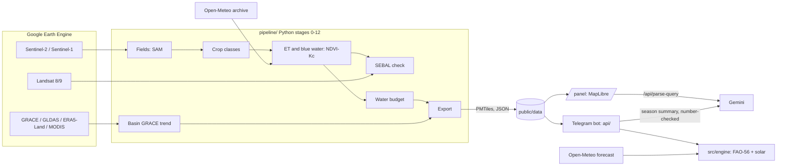

# SunWater Konya

**Satellite-measured groundwater use per field, a water budget for the Konya Closed Basin, and solar-aware irrigation advice for farmers.**

The Konya Closed Basin (Türkiye) is losing groundwater. In a closed basin the water that is actually used up is the **blue water use**: evapotranspiration of irrigated crops minus effective rainfall. SunWater Konya measures it for every field in a pilot area from satellite data, compares it with a water budget, shows the result to institutions on a map, and tells each farmer, over Telegram, how their field did and when to irrigate with solar power.

- **Pilot area:** north/north-west of Karapınar, 586 km², 3,448 fields detected from Sentinel-2.
- **Seasons:** 2025 (main) and 2024.
- **Rule:** nothing unmeasured is presented as measured; assumptions are labelled in the interface, and unverified figures are not used.

## What is in the repository

| Part | Where | What it does |
|---|---|---|
| Processing pipeline | `pipeline/` (Python, Google Earth Engine) | Field boundaries, crop classes, ET and blue water per field, SEBAL check, GRACE basin trend, water budget, web export (stages 0–12) |
| Farmer app | `/` (`src/farmer/`) | Pick a pilot field (map, location or number): this week's solar irrigation plan, season use against similar fields and efficient irrigation, savings options, Telegram link |
| Institutional panel | `/panel` (`src/panel/`) | Map of all fields by budget status, filters, natural-language query, field detail, season player, basin tab, method and validation page, CSV |
| Field planner | `/planla` (`src/App.tsx`, `src/engine/`) | FAO-56 water balance and solar pumping plan for a field drawn or described by the farmer (outside the pilot) |
| Telegram bot | `api/` | Links a farmer to a pilot field by location, sends the satellite season summary and the weekly solar irrigation plan |
| Documentation | `docs/` | `METHODOLOGY.md`, `VALIDATION.md`, `DATA_SOURCES.md` |

The decision log and the stage-by-stage plan are in `PLAN.md` (Turkish).

## Architecture



The pipeline runs offline and writes static files; the web app and the bot only read them. Gemini never produces numbers: every text it writes is checked so that it contains only numbers from the data, otherwise a fixed template is sent.

## Results in one paragraph (2025)

Measured blue water in the pilot: 221 million m³ (range 159–261). Against an efficient-irrigation (drip) reference, 801 of 3,147 irrigated fields are over budget and 1,570 borderline. An independent Landsat energy-balance model (SEBAL) gives about two-thirds of the NDVI-Kc values on crop days, a gap that is mostly structural (advection), so no calibration was applied. GRACE shows basin groundwater storage falling by 2.7 cm/yr (1.6 km³/yr) in 2018–2024, against no significant trend in 2003–2017. Details and limits: `docs/VALIDATION.md`.

## Setup

### Web app and API

Node 20.19+ or 22.12+ (Vite requirement).

```bash
npm install
cp .env.example .env.local   # fill in the keys you need
npm run dev                  # http://localhost:5173 (farmer app), /planla (field planner), /panel (panel)
npm test                     # vitest
npm run build                # type check + production build
```

`npm run dev` also serves the `/api/*` functions through a Vite middleware, so no Vercel CLI is needed locally. The panel reads `public/data/`, which is committed.

Out of season the farmer app can show a sample week (`/?field=F03053&demo=1`, or the button on the weekly card): the plan for the middle of the field's 2025 crop calendar, run on that week's archived weather. The weather comes from `public/data/demo_weather_2025.json` (Open-Meteo archive, six points over the pilot), so the demo works without the archive API; to rebuild it:

```powershell
Invoke-WebRequest -TimeoutSec 300 -OutFile public\data\demo_weather_2025.json -Uri "https://archive-api.open-meteo.com/v1/archive?latitude=37.75,37.75,37.75,37.85,37.85,37.85&longitude=33.35,33.45,33.55,33.35,33.45,33.55&start_date=2025-03-01&end_date=2025-11-30&daily=et0_fao_evapotranspiration,precipitation_sum&hourly=global_tilted_irradiance&tilt=30&azimuth=0&timezone=Europe%2FIstanbul"
```

For pilot fields the pump and solar values are the planner's demo values (60 m³/h, 50 kWp) whatever the field size; in midsummer they cover about 40 decares on sunny hours, larger fields get day-and-night pumping.

### Environment variables

All server-only (never prefix with `VITE_`); see `.env.example`.

| Variable | Needed for |
|---|---|
| `GEMINI_API_KEY`, `GEMINI_MODEL` (optional) | Natural-language query, farmer text parsing, message wording (templates are used without it) |
| `TELEGRAM_BOT_TOKEN` | Telegram bot |
| `TELEGRAM_DEMO_CHAT_ID` | Chat that receives the planner's "send alert" demo |
| `TELEGRAM_WEBHOOK_SECRET` | Optional webhook check |
| `TELEGRAM_POLLING=0` | Turns off local long-polling |
| `CRON_SECRET` | Protects the daily cron endpoint |
| `KV_REST_API_URL` / `KV_REST_API_TOKEN` (or `UPSTASH_REDIS_REST_*`) | Persistent bot storage (memory otherwise) |
| `PUBLIC_BASE_URL` | Optional, `https://…`: the bot's "Tarlamı aç" button and the chat menu button open the farmer home screen `/?field=<id>` inside Telegram (Mini App) |

### Processing pipeline

Python 3.11+ (developed on 3.13) with [uv](https://docs.astral.sh/uv/); a Google Earth Engine account and a Cloud project registered for Earth Engine (set in `pipeline/config.yaml` → `earth_engine.project`, or `EE_PROJECT`).

```bash
cd pipeline
uv sync                      # on Windows without uv on PATH: py -3.13 -m uv sync
uv run earthengine authenticate
uv run pytest -q
```

Run the stages in order (each writes to the git-ignored `pipeline/outputs/` and can be re-run; long Earth Engine steps cache their results):

| Stage | Command | Output |
|---|---|---|
| 0 | `uv run python 00_setup_check.py` | Access check of every data source |
| 1 | `uv run python 01_aoi.py` | Basin and pilot polygons, cropland stats |
| 2 | `uv run python 02_composites.py --wait` | Sentinel-2 dekadal composites (Earth Engine assets) |
| 3 | `uv run python 03b_merge_segments.py` then `uv run --extra sam python 03c_sam_segments.py` | Field boundaries (SAM ViT-H, CUDA GPU recommended; checkpoint path in config) |
| 4–6 | `04_label_data.py`, `05_features.py`, `06_classify.py` | Field features and crop classes |
| 7 | `07_et0.py` | Daily ET₀ and rain per weather cell |
| 8 | `08_et_ndvikc.py` | Daily ET and seasonal blue water per field |
| 9 | `09_sebal_validation.py` | SEBAL comparison and relative low-ET flag (~1 h, cached per overpass) |
| 10 | `10_basin_context.py` | GRACE/GLDAS basin series and trends |
| 11 | `11_budget.py` | Budgets, status, levers, pump energy |
| 12 | `12_export.py` | Web data, copied to `public/data/` |

The reference-drawing, labelling and checking tools used in stages 3–6 are dev-only pages: `/reference`, `/label`, `/check`.

## Deploy (Vercel)

The repository deploys as a Vite static site with Vercel functions in `api/`. `vercel.json` sets the `/panel` rewrite, function durations, the daily cron (07:00 Europe/Istanbul) and bundles `public/data` files into the bot functions. Set the environment variables above in the Vercel project. After deploying, register the Telegram webhook:

```bash
curl "https://api.telegram.org/bot$TELEGRAM_BOT_TOKEN/setWebhook" \
  -d "url=https://<your-app>.vercel.app/api/telegram-webhook" \
  -d "secret_token=$TELEGRAM_WEBHOOK_SECRET" \
  -d 'allowed_updates=["message","callback_query"]'

# check / remove
curl "https://api.telegram.org/bot$TELEGRAM_BOT_TOKEN/getWebhookInfo"
curl "https://api.telegram.org/bot$TELEGRAM_BOT_TOKEN/deleteWebhook"
```

## Telegram bot

- `/start` asks for the farmer's location; the bot finds the pilot field under it and asks for confirmation with a satellite snapshot with the field outline drawn on it (`sharp`; the plain snapshot if drawing fails) ("✅ Evet, bu tarla" / "➡️ Başka tarla"). `/start field_F01234` links a field directly; `/demo` links the demo field.
- **📊 Tarlamın durumu** (`/durum`): satellite season summary – blue water with its range, the median of similar fields, the efficient-irrigation reference. Out of season this is the default message.
- **📅 Haftalık plan**: 7-day solar pumping plan from the FAO-56 engine, with the crop calendar calibrated from the field's satellite season (sugar beet, maize, sunflower, irrigated wheat; other crops get the summary only).
- **✅ Suladım / 🌧 Yağmur yağdı**: written into the water balance as observed records, so the next plan starts from the real field state.

| Endpoint | Purpose |
| --- | --- |
| `POST /api/telegram-webhook` | Telegram updates |
| `GET /api/telegram-link?field=F01234` | Farmer app: bot deep link for a pilot field (`start=field_F01234`) |
| `POST /api/telegram-link` | Planner saves the current field and gets the `t.me/<bot>?start=<fieldId>` link (QR) |
| `POST /api/send-alert` | Planner "Telegram'a bildirim gönder": alert to the chats linked to the field and `TELEGRAM_DEMO_CHAT_ID` |
| `GET /api/send-alert` | Daily cron; silent out of season, adds a "Plan değişti" note when the plan moved |
| `POST /api/parse-query` | Panel natural-language query → filter JSON |

A bot cannot write first: open it in Telegram and press **Start** once. Locally, `npm run dev` long-polls Telegram (skipped when a webhook is set; only one process may poll a bot at a time). Telegram delivers a bot's updates either to its webhook or to polling, never both, so use two bots: the production bot (`@ciftci_sulama_kanali_ai_bot`, webhook on Vercel, token only in the Vercel settings) and a test bot (`@sunwater_konya_test_bot`, no webhook, token in `.env.local`). Never set a webhook on the test bot or put the production token in `.env.local`. Without Redis/KV, chats and records live in memory and are lost on serverless cold starts.

Assumptions used by the bot: rain buttons "az / orta / çok" = 5 / 15 / 30 mm; a typed duration ("6 saat") becomes `Q × hours / area × efficiency` mm; for pilot fields the irrigation method, soil, pump and solar values are the demo assumptions (sprinkler, 120 m head, pump efficiency 0.50).

## Limits

Satellites see consumption, not pumping: water that percolates back to the aquifer is invisible, and "over budget" means saving potential against efficient irrigation. Crop classes have no measured accuracy. There are no flux-tower or lysimeter measurements in the pilot; ET is a satellite estimate with a stated range. Water savings, emission reductions and any effect on sinkhole risk are targets to be evaluated with field data, not established outcomes.
